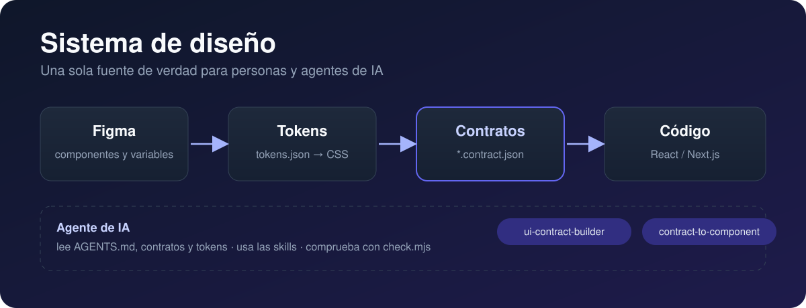
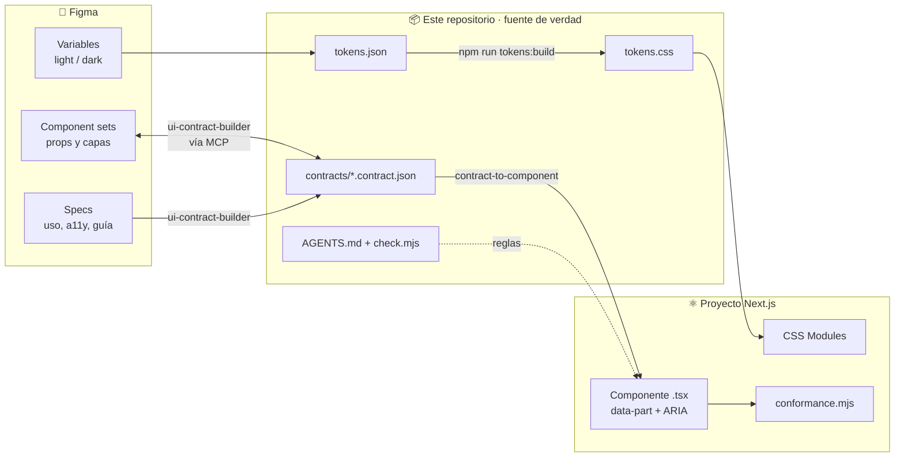
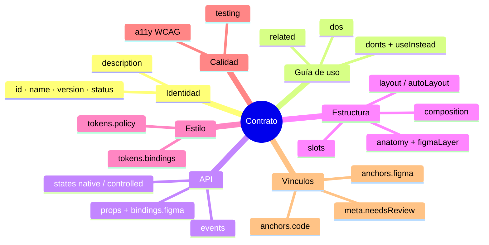
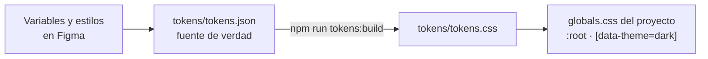
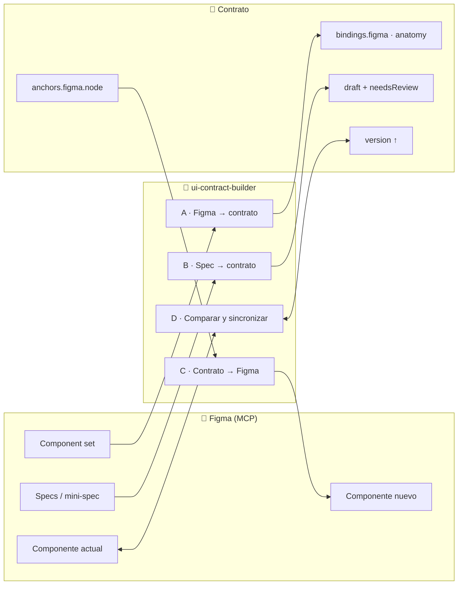
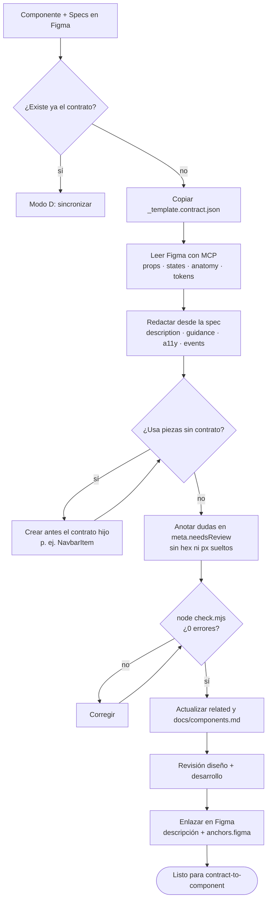
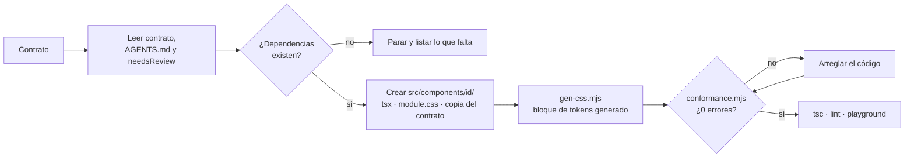
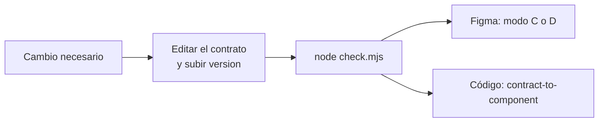

<p align="center">
  
</p>

<h1 align="center">SD Design System</h1>

<p align="center">
  <strong>Un sistema de diseño guiado por contratos.</strong><br>
  Figma diseña, el contrato acuerda y el código se verifica.<br>
  Personas y agentes de IA trabajan con la misma fuente de verdad.
</p>

<p align="center">
  
  
  
  
  
</p>
<p align="center">
  
  
  
  
  
  
  
</p>

<p align="center">
  <a href="#-qué-es">Qué es</a> ·
  <a href="#-cómo-encaja-todo">Cómo encaja</a> ·
  <a href="#-estructura-del-repositorio">Estructura</a> ·
  <a href="#-flujos-de-trabajo">Flujos</a> ·
  <a href="#-empezar">Empezar</a> ·
  <a href="#-documentación">Docs</a>
</p>

---

## 🧭 Qué es

Este repositorio guarda **todo lo que define el sistema de diseño en texto plano y versionable**, para que lo entiendan igual las personas y los agentes de IA:

| Pieza | Qué es | Dónde vive |
| --- | --- | --- |
| **Tokens** | Decisiones visuales con nombre (color, espacio, tipografía, radio, sombra), con modo claro y oscuro. | `tokens/` |
| **Contratos** | Un JSON por componente: para qué sirve y cuándo no usarlo, props, estados, anatomía, tokens, accesibilidad y vínculo con Figma. | `contracts/` |
| **Skills** | Instrucciones para agentes de IA (Claude Code) que crean contratos y componentes sin inventar nada. | `skills/` |
| **Reglas** | Lo que cualquier agente debe cumplir antes de tocar un componente. | `AGENTS.md` |
| **Utilidades** | Scripts que generan CSS, catálogos de iconos y validan la coherencia. | `scripts/`, `check.mjs` |

> **La idea clave:** Figma y el código **no se sincronizan solos**. Los dos se comparan con el mismo contrato. Si no coinciden, decides cuál es el correcto y cambias el otro.

---

## 🗺️ Cómo encaja todo



### ¿Qué es un contrato?

Un contrato es el **carnet de identidad** de un componente: el acuerdo neutral entre diseño y desarrollo.



Empieza por el contrato más corto, [`contracts/Divider.contract.json`](contracts/Divider.contract.json), y sigue con `Link` e `Icon`. `Button` es el más largo.

---

## 📁 Estructura del repositorio

```text
SD-Design-System/
├── README.md                     ← estás aquí
├── AGENTS.md                     Reglas para cualquier agente de IA en este repo
├── AGENTS.nextjs.md              Plantilla de AGENTS.md para el proyecto Next.js que consume el sistema
├── check.mjs                     Validador: contratos, tokens e iconos (sin dependencias)
├── package.json                  Scripts npm (tokens, check, iconos)
│
├── tokens/                       🎨 Decisiones visuales
│   ├── tokens.json               Única fuente de tokens (exportada de Figma, con modos)
│   └── tokens.css                GENERADO desde tokens.json: no se edita a mano
│
├── contracts/                    📜 Un contrato por componente
│   ├── component.schema.json     JSON Schema que valida todos los contratos
│   ├── _template.contract.json   Plantilla para un componente nuevo
│   ├── Button · IconButton · Link
│   ├── TextField · TextArea · Checkbox · RadioGroup · Switch
│   ├── Form · FormField
│   ├── Badge · Divider · AlertDialog
│   ├── Navbar · NavbarItem · Footer · FooterColumn
│   └── Icon · IconLibrary · PhosphorIconLibrary
│
├── skills/                       🤖 Skills para agentes (Claude Code)
│   ├── ui-contract-builder/      Figma ⇄ contrato (crear, comparar, dibujar)
│   │   ├── SKILL.md
│   │   ├── assets/               Esquema, plantilla y ejemplos (Link, IconButton)
│   │   ├── references/           contract-format · figma-reading · mini-spec ·
│   │   │                         composite-components · contract-to-figma · project-setup
│   │   └── scripts/check.mjs     Validador portátil para otros proyectos
│   └── contract-to-component/    Contrato → React + TypeScript verificado
│       ├── SKILL.md
│       ├── assets/example/icon-button/   Componente real que pasa el verificador
│       ├── references/           implementation-map · parity
│       └── scripts/              gen-css.mjs · conformance.mjs · lib.mjs
│
├── icons/                        🔣 Registros de iconos permitidos (un proyecto usa una librería)
│   ├── lucide/                   registry.json · catalog.json · icons.ts
│   └── phosphor/                 registry.json · catalog.json · icons.ts
│
├── scripts/                      ⚙️ Generadores
│   ├── build-tokens.mjs          tokens.json → tokens.css
│   ├── build-lucide-icons.mjs    registro Lucide → icons.ts
│   ├── build-lucide-catalog.mjs  catálogo completo de Lucide
│   ├── build-lucide-figma.mjs    paso de iconos Lucide a Figma
│   ├── build-phosphor-icons.mjs  registro Phosphor → icons.ts
│   ├── build-phosphor-catalog.mjs
│   └── build-phosphor-figma.mjs
│
└── docs/                         📚 Guías
    ├── assets/banner.svg         Portada de este README
    ├── contract-guide.md         Qué es un contrato y cómo rellenarlo
    ├── figma.md                  Preparar Figma y conectarlo con el contrato
    ├── tokens-from-figma.md      Cómo se exportan y representan los tokens
    ├── components.md             Índice de componentes y vocabulario de props
    ├── icons.md                  Iconos (Lucide / Phosphor)
    ├── nextjs.md                 Llevar el sistema a un proyecto Next.js
    ├── prompts-nextjs.md         Prompts listos para usar con el agente
    └── ejercicios.md             Ejercicios prácticos
```

---

## 🔄 Flujos de trabajo

### 1. Tokens: de Figma al CSS



- Los alias se escriben como `{ruta.del.token}`. Los componentes usan la capa semántica, que apunta a primitivos.
- El modo oscuro se aplica solo con `[data-theme="dark"]`, así que **nunca se escriben valores distintos para dark**.

### 2. La skill `ui-contract-builder`: Figma ⇄ contrato vía MCP

Es **bidireccional**. Lee y escribe en Figma a través del servidor MCP y tiene cuatro modos:



| Modo | Cuándo | Qué hace |
| --- | --- | --- |
| **A** | El componente ya existe en Figma | Lee el nodo **en solo lectura** y rellena lo mecánico: props, estados, anatomía, layout, tokens y anchors. |
| **B** | Solo hay una spec | Crea el contrato en `draft`. Las decisiones propuestas van a `meta.needsReview`. |
| **C** | El contrato existe y Figma no | Dibuja el component set **enlazado a variables reales**. Si falta una variable, se detiene. |
| **D** | Ha cambiado algo | Lista las diferencias. No cambia nada hasta que decides cuál de los dos manda. |

### 3. Crear el contrato de un componente diseñado en Figma



### 4. La skill `contract-to-component`: del contrato al código



`conformance.mjs` garantiza que las props, tipos, defaults, partes (`data-part`), estados, ARIA y tokens sean los del contrato, sin hex, sin px sueltos y sin `opacity` en disabled.

### 5. Cuando algo cambia: primero el contrato



| Cambio | Versión |
| --- | --- |
| Texto, descripción o guía | `patch` (0.1.**x**) |
| Prop o estado nuevo | `minor` (0.**x**.0) |
| Renombrar o quitar una prop o una propiedad de Figma | `major` (**x**.0.0) |

---

## 🚀 Empezar

**Requisitos:** [Node.js](https://nodejs.org/) 18+. La validación no necesita instalar dependencias.

```bash
# Validar contratos, tokens e iconos
node check.mjs

# Regenerar las variables CSS después de cambiar tokens.json
npm run tokens:build

# Iconos Phosphor: registro, catálogo y paso a Figma
npm run phosphor:build
npm run phosphor:catalog
npm run phosphor:figma
```

### Pasos a seguir

1. **Prepara Figma:** variables con nombre por uso (`color/fill/brand/default`), component sets con propiedades claras, auto layout y capas con el mismo nombre que las claves de `anatomy`. Ver [`docs/figma.md`](docs/figma.md).
2. **Vuelca los tokens** a `tokens/tokens.json` y ejecuta `npm run tokens:build`.
3. **Crea el contrato** con `ui-contract-builder` (modo A o B) o a mano desde la plantilla.
4. **Valida** con `node check.mjs` hasta que no queden errores y revisa `meta.needsReview` con el equipo.
5. **Dibuja o compara en Figma** con los modos C y D.
6. **Implementa** con `contract-to-component` y pasa `conformance.mjs`.
7. **Registra** el componente en `docs/components.md` y haz commit.

### Con Claude Code

```text
Crea el contrato de este componente de Figma: <enlace al nodo>
Compara el componente de Figma <enlace> con contracts/Navbar.contract.json
Dibuja en Figma el componente Badge desde su contrato
Implementa el componente Button desde su contrato
```

El agente lee [`AGENTS.md`](AGENTS.md) antes de tocar nada. **Si algo no está en el contrato, pregunta. No rellena huecos con suposiciones.**

---

## 📏 Reglas de oro

- ✅ Solo se usan tokens de `tokens.bindings` y de las categorías de `tokens.policy.allowed`.
- ✅ Cada parte de `anatomy` lleva `data-part="<clave>"` y el `ref` va en `semantics.refTarget`.
- ✅ Los estados `native` se resuelven con CSS y los `controlled` son props con su atributo ARIA.
- ❌ Ni colores hex ni px sueltos.
- ❌ Disabled nunca se hace con `opacity`: se usan los tokens `*.disabled`.
- ❌ `tokens.css` no se edita a mano.
- ❌ Ningún cambio en código ni en Figma antes que en el contrato.

---

## 📚 Documentación

| Documento | Para qué sirve |
| --- | --- |
| [`docs/contract-guide.md`](docs/contract-guide.md) | Cómo funciona un contrato y cómo rellenarlo |
| [`docs/figma.md`](docs/figma.md) | Preparar Figma y conectarlo con el contrato |
| [`docs/tokens-from-figma.md`](docs/tokens-from-figma.md) | Tokens: origen, modos y generación de CSS |
| [`docs/components.md`](docs/components.md) | Índice de componentes y vocabulario de props |
| [`docs/icons.md`](docs/icons.md) | Iconos con Lucide o Phosphor |
| [`docs/nextjs.md`](docs/nextjs.md) | Llevar el sistema a un proyecto Next.js |
| [`docs/prompts-nextjs.md`](docs/prompts-nextjs.md) | Prompts listos para trabajar con el agente |
| [`docs/ejercicios.md`](docs/ejercicios.md) | Ejercicios prácticos para aprender el sistema |

---

## 🧩 Valores de ejemplo

`tokens/tokens.json` trae las variables de **Radix Themes (Community)** tal como salen de Figma, y los contratos de ejemplo usan esos nombres. Si trabajas con tu propio Figma, sustitúyelas siguiendo [`docs/tokens-from-figma.md`](docs/tokens-from-figma.md) y adapta los `tokens.bindings`.

## 🚫 Qué no incluye (a propósito)

CI, Storybook y un generador de documentación. Se añaden cuando hagan falta.

---

<p align="center">
  Hecho con 🎨 Figma · 📜 contratos · 🤖 Claude Code<br>
  <sub>Contrato primero, y luego Figma y código.</sub>
</p>